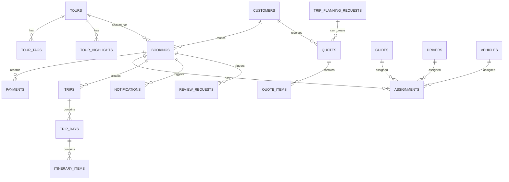

# Database Design

PostgreSQL is managed by Flyway. The current migrations are:

- `V1__init_platform_schema.sql`: core platform schema.
- `V2__seed_development_data.sql`: representative development data.

## Design Principles

- Tour data is normalized enough to avoid duplicated pricing and content.
- Bookings keep denormalized customer fields for operational continuity, while optional `customer_id` supports CRM linkage.
- Public references are separate from primary keys.
- Future operational domains exist as tables, but implementation remains modular and incremental.

## Mermaid ER Diagram

## Core Tables

- `tours`: catalogue content, pricing, SEO, status, and category.
- `tour_*`: ordered collections for tags, locations, highlights, inclusions, exclusions, itinerary, and FAQ.
- `bookings`: booking reference, selected tour, date, guest count, customer contact snapshot, pickup, status, and amounts.
- `trip_planning_requests`: guided custom itinerary intake.
- `customers`: CRM profile data with minimal fields.
- `guides`, `drivers`, `vehicles`, `assignments`: operations resources.
- `quotes`, `quote_items`: custom quotation workflow.
- `payments`: manual payment abstraction, ready for provider transactions later.
- `trips`, `trip_days`, `itinerary_items`: customer portal itinerary model.
- `notifications`, `review_requests`: future communication workflows.

## Status Models

Booking statuses: `ENQUIRY`, `QUOTE_PENDING`, `QUOTE_SENT`, `AWAITING_PAYMENT`, `CONFIRMED`, `GUIDE_ASSIGNED`, `READY`, `IN_PROGRESS`, `COMPLETED`, `CANCELLED`, `REFUNDED`.

Quote statuses: `DRAFT`, `SENT`, `ACCEPTED`, `DECLINED`, `EXPIRED`.

Payment statuses: `PENDING`, `PROCESSING`, `PAID`, `FAILED`, `REFUNDED`, `PARTIALLY_REFUNDED`.

## Operations migrations (V7–V11)

| Migration | Adds |
|---|---|
| V7 `enquiries_inbox` | `enquiries` (status, source, requested tour/date/time/duration/pickup/destination/passengers, idempotency key, conversion link), `enquiry_notes`. Backfills existing trip planner requests. |
| V8 `drivers_and_private_media` | `DRIVER` role, `media_files`, driver account link and verification fields, `driver_documents`. |
| V9 `fleet_assignments_inspections` | `operations_settings`; vehicle display name, category, operational and listing status (legacy `status` kept, no longer written; `MAINTENANCE` migrated to restrictions); `vehicle_amenities`, `vehicle_images`, `vehicle_restrictions`; assignment time windows, `blocked_until` (end + turnaround), status values and **btree_gist exclusion constraints** against overlapping vehicle or driver assignments; `vehicle_inspections` (one live collection and return per assignment), `inspection_photos`. |
| V10 `private_trip_booking` | `bookings.booking_type` (tour_id now optional for private trips), idempotency key; `private_trip_rates` (seeded **SAMPLE** rates), per-vehicle rate overrides, `private_trip_fees`, `private_trip_details` with the stored price breakdown. |
| V11 `site_images` | Administrator-managed hero and gallery images (inactive until activated). |

| V12 `flag_development_seed_data` | `demo_data` flags on the fixed-ID V2 sample rows (no deletions). |
| V13 `activity_catalogue` | `activities`, `activity_sources`, `activity_price_rules`, `activity_extras`, `activity_hours`, `activity_faqs`; day-planner `planning_areas` and `planning_settings`. |
| V14 `seed_verified_activities` | 18 published and 5 draft activities researched on 3 Oct 2026, with sources, price rules, hours and FAQs. |

Assignment statuses: `SCHEDULED`, `AWAITING_RELEASE`, `RELEASED`, `RETURNED`, `CLOSED`, `CANCELLED`.
Enquiry statuses: `NEW`, `IN_PROGRESS`, `AWAITING_CUSTOMER`, `CONVERTED`, `CLOSED`.
V9 runs `create extension if not exists btree_gist`. Two separate conditions must hold; see
[Deployment](../operations/DEPLOYMENT.md#database-prerequisites-for-v9):

- **Availability**: the extension's files must be installed on the PostgreSQL server (the contrib package).
  The official `postgres:16-alpine` image includes it. A managed provider must list `btree_gist` as a supported extension.
- **Permission**: `btree_gist` is marked *trusted* (PostgreSQL 13+), so a non-superuser may create it, but only with
  `CREATE` privilege on the database (for example as the database owner). Verified locally: a non-superuser database owner
  can create it; a non-superuser without `CREATE` gets `permission denied to create extension "btree_gist"`. The local Docker
  role is a superuser, so local success does not prove a restricted production role will work.
